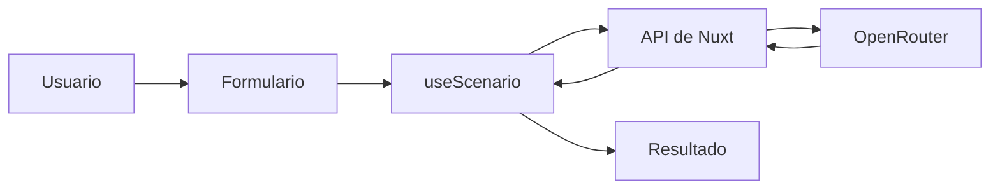
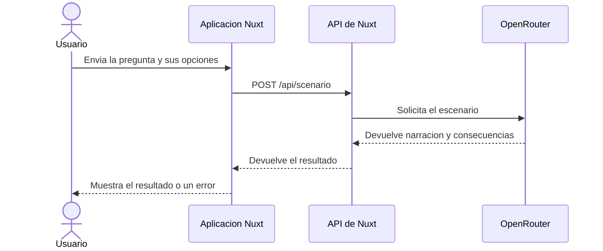

# ¿Qué habría pasado si...?

Aplicación web para plantear una hipótesis y explorar una posible historia alternativa. El proyecto se ha desarrollado en clase por Mario Hernández y Alejandro Suarez.

## Qué permite hacer

Escribe una pregunta de hasta 280 caracteres, elige un año de referencia entre 0 y 3000 y selecciona un estilo: realista, ilusionante o descerebrado. Al enviar el formulario, la aplicación pide a una IA una historia y varias consecuencias.

El año es un dato de contexto para la respuesta. La aplicación muestra los estados de carga y error, y conserva la pregunta si falla la solicitud.

## Requisitos

### Funcionales

- **RF-01.** Permitir escribir una pregunta obligatoria de hasta 280 caracteres.
- **RF-02.** Permitir elegir un año entero entre 0 y 3000, ambos incluidos.
- **RF-03.** Permitir elegir entre los estilos realista, ilusionante y descerebrado.
- **RF-04.** Enviar esos datos a la IA y mostrar una narración y sus consecuencias, o un mensaje de error.

### No funcionales

- **RNF-01.** Mantener la clave de OpenRouter en el servidor, configurada mediante `.env` y fuera del control de versiones.
- **RNF-02.** Validar los datos también en el servidor; no confiar únicamente en las restricciones del formulario.
- **RNF-03.** Mostrar la interfaz y los mensajes en español.
- **RNF-04.** Ejecutar la aplicación con el servidor de Nuxt; la generación estática no ejecuta la ruta de IA.

## Cómo funciona

La página guarda los campos y `useScenario` (es un composable) envía la consulta a una ruta del servidor Nuxt. Esa ruta valida los datos y llama a OpenRouter. La clave de API solo se lee en el servidor.





## Configurar OpenRouter

La aplicación usa el modelo `openrouter/free` de OpenRouter.

1. Crear una clave de API en OpenRouter.
2. Si todavía no tienes un archivo `.env`, copia `.env.example` y ponle ese nombre.
3. Añade tu clave en `.env`:

```env
NUXT_OPENROUTER_API_KEY=tu_clave_de_api
NUXT_OPENROUTER_MODEL=openrouter/free
```


## Puesta en marcha

Necesitas Node.js y npm. Instala las dependencias e inicia el servidor:

```bash
npm install
npm run dev
```

Para comprobar la compilación de producción, ejecuta `npm run build`. La generación de respuestas necesita una aplicación Nuxt con servidor, porque la API está en `server/api`.

## Pruebas

Ejecuta las pruebas unitarias con:

```bash
npm test
```

La suite comprueba la validación que comparte la API: pregunta obligatoria y longitud máxima, años enteros entre 0 y 3000, y niveles permitidos. No llama a OpenRouter ni necesita una clave. Para verificar además la compilación, ejecuta `npm run build`.

| Caso | Entrada | Resultado esperado |
| --- | --- | --- |
| T-01 | Pregunta vacía o solo espacios | La consulta se rechaza. |
| T-02 | Pregunta de 280 caracteres y de 281 caracteres | La primera se acepta; la segunda se rechaza. |
| T-03 | Años 0 y 3000; años -1 y 3001 | Se aceptan los límites; se rechazan los valores exteriores. |
| T-04 | Cada uno de los tres estilos disponibles | Los tres se aceptan; un estilo desconocido se rechaza. |

## Tecnologías

- [Nuxt 3](https://nuxt.com/) y [Vue 3](https://vuejs.org/)
- TypeScript y Tailwind CSS
- OpenRouter para acceder al modelo de IA
- npm para instalar dependencias y ejecutar la aplicación

## Organización del proyecto

```text
pages/index.vue                    Página principal y coordinación del formulario
components/HypothesisForm.vue      Entrada de la pregunta
components/TimeLine.vue            Selector del año de referencia
components/UnrealismSelector.vue   Selector del estilo de respuesta
components/ScenarioResult.vue      Resultado, carga y errores
composables/useScenario.ts         Estado y solicitud del escenario
server/api/scenario.post.ts        Validación y llamada a OpenRouter
server/utils/scenario-query.ts     Validación reutilizable de la consulta
tests/scenario-query.test.ts       Pruebas unitarias de la validación
types/scenario.ts                  Tipos de consulta, resultado y estado
nuxt.config.ts                     Configuración de Nuxt
.env.example                       Plantilla de variables locales
```
