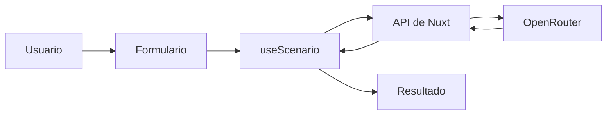
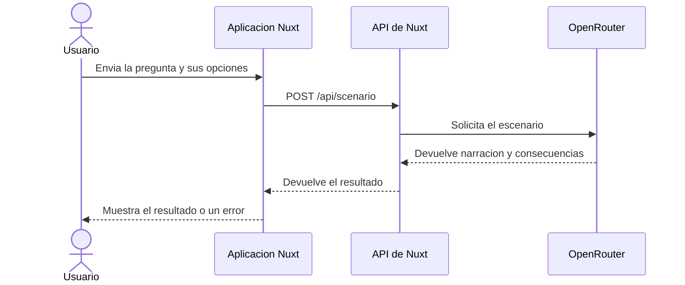

# ¿Qué habría pasado si...?

Aplicación web para plantear una hipótesis y explorar una posible historia alternativa. El proyecto se ha desarrollado en clase por Mario Hernández y Alejandro Suárez.

## Datos del documento

| Campo | Valor |
|---|---|
| Nombre del proyecto | ¿Qué habría pasado si...? |
| Autores | Mario Hernández y Alejandro Suárez |
| Fecha | 13/10/2026 |
| Versión | 1.0 |
| Estado | Desarrollo |

## 1. Introducción

### 1.1. Propósito del documento

Este documento describe qué debe hacer la aplicación "¿Qué habría pasado si...?" y las condiciones que debe cumplir. Sirve de referencia para el equipo de desarrollo durante la implementación y las pruebas, y para que el docente pueda comprobar que el resultado final cumple lo especificado.

### 1.2. Problema y objetivos

**Problema o necesidad:** a veces resulta entretenido imaginar cómo habría cambiado la historia si un hecho concreto hubiera ocurrido de otra manera, pero pensar una respuesta coherente (con narración y consecuencias) requiere tiempo y creatividad. No existía ninguna herramienta propia que, a partir de una pregunta y un año, generase automáticamente una historia alternativa.

| ID | Objetivo del proyecto | Indicador de logro |
|---|---|---|
| OBJ-01 | Permitir a cualquier usuario plantear una hipótesis histórica y recibir una historia alternativa generada automáticamente. | Al enviar una pregunta válida, el sistema muestra una narración y al menos 3 consecuencias, o un mensaje de error claro si algo falla. |
| OBJ-02 | Adaptar el tono de la respuesta al gusto del usuario. | Las tres opciones de estilo (realista, ilusionante, descerebrado) producen resultados con un tono distinto. |
| OBJ-03 | Mantener la aplicación sencilla de usar, sin registro ni pasos previos. | Un usuario nuevo puede obtener un resultado sin crear cuenta ni configurar nada en la interfaz. |

### 1.3. Alcance

**El sistema incluirá:**

- Un formulario para escribir la pregunta, elegir el año y elegir el estilo de la respuesta.
- El envío de esos datos a una IA (a través de OpenRouter) mediante la propia API del servidor Nuxt.
- La visualización de la narración y las consecuencias generadas, con sus estados de carga y error.

**Queda fuera del alcance:**

- Guardar un historial de preguntas o resultados anteriores.
- Registro o inicio de sesión de usuarios.
- Compartir o exportar el resultado (PDF, redes sociales, etc.).
- Elegir o cambiar el modelo de IA desde la propia interfaz.

### 1.4. Definiciones y abreviaturas

| Término | Definición |
|---|---|
| ERS | Especificación de Requisitos del Software. |
| IA | Inteligencia artificial; en este caso, el modelo de lenguaje que genera la historia alternativa. |
| Nivel de irrealismo | Estilo de la respuesta: realista, ilusionante o descerebrado. |
| OpenRouter | Servicio externo que da acceso al modelo de IA usado por la aplicación. |
| Composable | Función de Vue/Nuxt reutilizable que encapsula estado y lógica (en este proyecto, `useScenario`). |
| Servidor de Nuxt | Parte de la aplicación que se ejecuta en el servidor, necesaria porque la llamada a la IA no puede hacerse desde el navegador. |

### 1.5. Referencias y fuentes

| ID | Fuente | Fecha o versión | Ubicación |
|---|---|---|---|
| FUE-01 | Enunciado de la práctica proporcionado por el docente. | [Pendiente] | Archivo `¿Qué habría pasado si.pdf` en la raíz del proyecto. |
| FUE-02 | Documentación de la API de OpenRouter. | Consultada durante el desarrollo. | https://openrouter.ai |
| FUE-03 | Documentación oficial de Nuxt 3. | Consultada durante el desarrollo. | https://nuxt.com |

## 2. Descripción general del sistema

### 2.1. Contexto y perspectiva del producto

Es una aplicación nueva, independiente, sin relación con sistemas anteriores del equipo. Se usa desde el navegador como página web y depende del servicio externo OpenRouter para generar el contenido con IA. El diagrama de la sección "Cómo funciona" (más abajo) muestra el contexto completo.

### 2.2. Personas interesadas y tipos de usuario

| ID | Persona, colectivo o rol | Necesidad o responsabilidad | Permisos y conocimientos relevantes |
|---|---|---|---|
| ACT-01 | Usuario de la aplicación | Escribir una hipótesis y leer la historia alternativa que genera. | No necesita registrarse ni tener conocimientos técnicos. |
| ACT-02 | Persona que pone en marcha el proyecto (desarrollador) | Configurar la clave de OpenRouter y ejecutar el servidor. | Conocimientos básicos de Node.js/Nuxt y acceso al archivo `.env`. |
| ACT-03 | Docente o evaluador | Comprobar que la aplicación cumple los requisitos descritos. | Acceso al código del proyecto y a este documento. |

### 2.3. Funciones principales

- Escribir una pregunta de hasta 280 caracteres.
- Elegir un año de referencia entre 0 y 3000.
- Elegir el estilo de la respuesta (realista, ilusionante o descerebrado).
- Generar y mostrar una historia alternativa con sus consecuencias.
- Mostrar los estados de carga y de error sin perder la pregunta escrita.

### 2.4. Entorno de uso

| Aspecto | Descripción |
|---|---|
| Dispositivos y plataformas | Navegador de escritorio o móvil, cualquier sistema operativo moderno. |
| Condiciones de uso | Requiere conexión a internet, tanto para cargar la página como para consultar OpenRouter. |
| Volumen esperado | Uso individual en un entorno de clase o pruebas; no se ha dimensionado para tráfico alto. |

### 2.5. Restricciones

| ID | Restricción | Origen o justificación |
|---|---|---|
| RES-01 | La aplicación debe estar hecha con Nuxt 3 y Vue 3. | Tecnología elegida por el equipo para la práctica. |
| RES-02 | La IA debe consultarse mediante OpenRouter, con el modelo configurado por variable de entorno. | Decisión del equipo, para no exponer la clave de API en el cliente. |
| RES-03 | La interfaz y los mensajes deben estar en español. | Decisión del equipo. |
| RES-04 | No puede usarse `nuxt generate` (sitio estático) porque la IA necesita un servidor. | Limitación técnica: la ruta de IA vive en `server/api` y necesita el runtime de Nuxt con servidor. |

### 2.6. Suposiciones y dependencias

| ID | Tipo | Descripción | Consecuencia si no se cumple |
|---|---|---|---|
| SUP-01 | Suposición | El usuario que despliega la aplicación dispone de una clave de API de OpenRouter válida y con acceso al modelo configurado. | Sin ella, la aplicación no puede generar ninguna historia (la API responde con error 503). |
| DEP-01 | Dependencia | Servicio externo OpenRouter. | Si no está disponible o cambia su API, la generación de historias falla. |
| DEP-02 | Dependencia | Node.js y npm instalados en el equipo de desarrollo. | Sin ellos no se puede instalar ni ejecutar el proyecto. |

## 3. Requisitos funcionales

**Prioridades:** Alta = imprescindible para la versión prevista; Media = importante, pero puede aplazarse mediante acuerdo; Baja = deseable.

### 3.1. Catálogo de requisitos funcionales

| ID | Nombre | Prioridad | Fuente | Estado |
|---|---|---|---|---|
| RF-01 | Escribir la pregunta | Alta | FUE-01 | Validado |
| RF-02 | Elegir el año de referencia | Alta | FUE-01 | Validado |
| RF-03 | Elegir el estilo de la respuesta | Alta | FUE-01 | Validado |
| RF-04 | Generar y mostrar el escenario | Alta | FUE-01 | Validado |
| RF-05 | Conservar los datos al mostrar un error | Media | FUE-01 | Validado |

### 3.2. Fichas de requisito funcional

#### RF-01. Escribir la pregunta

| Campo | Descripción |
|---|---|
| Enunciado | El sistema deberá permitir que el usuario escriba una pregunta obligatoria de hasta 280 caracteres. |
| Justificación | La pregunta es la hipótesis sobre la que la IA construye la historia; sin ella no se puede generar nada. |
| Actor | Usuario (ACT-01) |
| Prioridad | Alta |
| Fuente | FUE-01 |
| Precondiciones | El usuario ha abierto la página principal. |
| Entradas | Texto de la pregunta. |
| Comportamiento esperado | El sistema permite escribir y editar la pregunta, y comprueba su longitud antes de enviar el formulario. |
| Salidas y postcondiciones | La pregunta queda guardada en el estado de la página hasta que se envía o se reinicia el formulario. |
| Errores o alternativas | Si la pregunta está vacía (o solo tiene espacios) o supera los 280 caracteres, el sistema impide el envío. |
| Dependencias | RF-04 |

**Criterios de aceptación:**

- **CA-RF01-01:** Dado el formulario, cuando el usuario escribe una pregunta de 280 caracteres o menos y pulsa enviar, entonces el sistema la acepta y continúa con la petición.
- **CA-RF01-02:** Dado el formulario, cuando el usuario deja la pregunta vacía o escribe más de 280 caracteres y pulsa enviar, entonces el sistema rechaza la petición y no la envía a la IA.

#### RF-02. Elegir el año de referencia

| Campo | Descripción |
|---|---|
| Enunciado | El sistema deberá permitir elegir un año entero entre 0 y 3000, ambos incluidos, mediante el selector de línea de tiempo. |
| Justificación | El año da contexto histórico a la hipótesis planteada. |
| Actor | Usuario (ACT-01) |
| Prioridad | Alta |
| Fuente | FUE-01 |
| Precondiciones | El usuario ha abierto la página principal. |
| Entradas | Año elegido en el selector. |
| Comportamiento esperado | El selector solo permite valores enteros entre 0 y 3000. |
| Salidas y postcondiciones | El año queda guardado en el estado de la página junto con el resto de datos del formulario. |
| Errores o alternativas | Un año fuera de ese rango, o no entero, se rechaza antes de llamar a la IA. |
| Dependencias | RF-04 |

**Criterios de aceptación:**

- **CA-RF02-01:** Dado el selector de año, cuando el usuario elige 0 o 3000, entonces el sistema acepta el valor.
- **CA-RF02-02:** Dado el selector de año, cuando se envía un valor menor que 0 o mayor que 3000, entonces el sistema lo rechaza.

#### RF-03. Elegir el estilo de la respuesta

| Campo | Descripción |
|---|---|
| Enunciado | El sistema deberá permitir elegir entre los estilos realista, ilusionante y descerebrado. |
| Justificación | El estilo determina el tono con el que la IA debe redactar la historia. |
| Actor | Usuario (ACT-01) |
| Prioridad | Alta |
| Fuente | FUE-01 |
| Precondiciones | El usuario ha abierto la página principal. |
| Entradas | Estilo elegido en el selector. |
| Comportamiento esperado | El selector solo ofrece los tres estilos admitidos. |
| Salidas y postcondiciones | El estilo queda guardado en el estado de la página junto con el resto de datos del formulario. |
| Errores o alternativas | Un valor de estilo distinto de los tres permitidos se rechaza antes de llamar a la IA. |
| Dependencias | RF-04 |

**Criterios de aceptación:**

- **CA-RF03-01:** Dado el selector de estilo, cuando el usuario elige uno de los tres estilos, entonces el sistema lo acepta.
- **CA-RF03-02:** Dado un valor de estilo distinto de los tres permitidos, cuando llega a la API, entonces el sistema lo rechaza con un error de validación.

#### RF-04. Generar y mostrar el escenario

| Campo | Descripción |
|---|---|
| Enunciado | El sistema deberá enviar la pregunta, el año y el estilo a la IA (a través de OpenRouter) y mostrar la narración y las consecuencias que devuelva. |
| Justificación | Es la función principal de la aplicación: convertir la hipótesis del usuario en una historia alternativa. |
| Actor | Usuario (ACT-01) |
| Prioridad | Alta |
| Fuente | FUE-01 |
| Precondiciones | RF-01, RF-02 y RF-03 cumplidos (datos válidos). |
| Entradas | Pregunta, año y estilo validados. |
| Comportamiento esperado | La API del servidor valida los datos, construye la petición a OpenRouter y, si la respuesta tiene el formato esperado, devuelve una narración y entre 3 y 5 consecuencias. |
| Salidas y postcondiciones | La narración y las consecuencias se muestran en pantalla. |
| Errores o alternativas | Si no hay clave de API configurada, si OpenRouter no responde o si la respuesta no tiene el formato esperado, el sistema muestra un mensaje de error en vez de un resultado. |
| Dependencias | RF-01, RF-02, RF-03, INT-01 |

**Criterios de aceptación:**

- **CA-RF04-01:** Dado un formulario con datos válidos, cuando el usuario lo envía, entonces el sistema muestra la narración y al menos 3 consecuencias generadas por la IA.
- **CA-RF04-02:** Dado un error en la llamada a OpenRouter (sin clave configurada, sin respuesta o respuesta con formato incorrecto), cuando el usuario envía el formulario, entonces el sistema muestra un mensaje de error en lugar de un resultado.

#### RF-05. Conservar los datos al mostrar un error

| Campo | Descripción |
|---|---|
| Enunciado | El sistema deberá conservar la pregunta y el resto de datos escritos cuando una petición falle. |
| Justificación | Evita que el usuario tenga que volver a escribir todo si la IA falla una vez. |
| Actor | Usuario (ACT-01) |
| Prioridad | Media |
| Fuente | FUE-01 |
| Precondiciones | Se ha enviado el formulario y la petición ha terminado en error. |
| Entradas | Ninguna adicional; reutiliza los datos ya escritos. |
| Comportamiento esperado | Al mostrar el mensaje de error, los campos del formulario mantienen los valores introducidos por el usuario. |
| Salidas y postcondiciones | El usuario puede corregir o reenviar el formulario sin volver a escribir todo desde cero. |
| Errores o alternativas | No aplica. |
| Dependencias | RF-04 |

**Criterios de aceptación:**

- **CA-RF05-01:** Dado un envío que termina en error, cuando el sistema muestra el mensaje de error, entonces los campos del formulario conservan los valores que el usuario había introducido.

## 4. Requisitos no funcionales

| ID | Categoría | Requisito medible | Condiciones de comprobación | Criterio de aceptación | Prioridad |
|---|---|---|---|---|---|
| RNF-01 | Seguridad y privacidad | La clave de API de OpenRouter solo debe usarse en el servidor, configurada mediante `.env`, y no debe quedar expuesta en el cliente ni en el control de versiones. | Revisión del código fuente y de las peticiones de red visibles desde el navegador. | La clave no aparece en ningún archivo del cliente ni en las peticiones que ve el navegador, y `.env` no está en el repositorio. | Alta |
| RNF-02 | Fiabilidad | Los datos de entrada deben validarse también en el servidor, no solo en el formulario. | Enviar una petición directamente a `/api/scenario` con datos inválidos, sin pasar por el formulario. | La API responde con error 400 y no llega a llamar a OpenRouter. | Alta |
| RNF-03 | Usabilidad | La interfaz y los mensajes, incluidos los de error, deben mostrarse en español. | Revisión visual de todas las pantallas y mensajes de la aplicación. | Ningún texto de la interfaz aparece en otro idioma. | Media |
| RNF-04 | Compatibilidad | La aplicación debe ejecutarse con el servidor de Nuxt; la generación estática (`nuxt generate`) no incluye la ruta de IA. | Ejecutar `npm run generate` y comprobar el resultado. | La ruta `/api/scenario` no funciona en el sitio estático generado; la aplicación debe ejecutarse con `npm run dev` o `npm run build` + servidor. | Alta |

## 5. Datos y reglas de negocio

### 5.1. Información que gestionará el sistema

| ID | Entidad o conjunto de datos | Campos principales | Validaciones | Acceso y conservación |
|---|---|---|---|---|
| DAT-01 | Consulta del usuario (`ScenarioQuery`) | `question` (texto), `year` (entero), `unrealismLevel` (texto) | `question`: obligatoria, sin espacios en blanco, máximo 280 caracteres. `year`: entero entre 0 y 3000. `unrealismLevel`: debe ser `realista`, `ilusionante` o `descerebrado`. | Solo se usa durante la petición; no se guarda en ninguna base de datos ni archivo. |
| DAT-02 | Resultado generado (`ScenarioResult`) | `question` (la misma enviada), `narrative` (texto), `consequences` (lista de textos) | `narrative` debe ser texto; `consequences` debe ser una lista de entre 3 y 5 textos. | Se muestra en pantalla y se pierde al recargar la página o reiniciar el formulario; no se persiste. |

### 5.2. Reglas de negocio

| ID | Regla | Requisitos relacionados | Fuente |
|---|---|---|---|
| RN-01 | El año debe ser un número entero entre 0 y 3000; no se permiten decimales ni valores fuera de ese rango. | RF-02 | FUE-01, decisión del equipo |
| RN-02 | El estilo de la respuesta debe ser siempre uno de los tres valores admitidos (realista, ilusionante, descerebrado); cualquier otro valor se rechaza. | RF-03 | Decisión del equipo |
| RN-03 | La narración y las consecuencias solo se muestran si la IA devuelve una respuesta con el formato esperado (JSON con `narrative` y `consequences`); en caso contrario se trata como un error. | RF-04 | Decisión del equipo |

## 6. Interfaces externas

### 6.1. Interfaz de usuario

| ID | Pantalla o interacción | Usuarios | Información y acciones necesarias | Requisitos relacionados |
|---|---|---|---|---|
| IU-01 | Formulario de la hipótesis | Usuario | Campo de pregunta, selector de año, selector de estilo y botón de envío. | RF-01, RF-02, RF-03 |
| IU-02 | Resultado del escenario | Usuario | Narración, lista de consecuencias, indicador de carga y mensaje de error. | RF-04, RF-05 |

Las pantallas reales son los propios componentes Vue del proyecto (`HypothesisForm.vue`, `TimeLine.vue`, `UnrealismSelector.vue` y `ScenarioResult.vue`); no se han hecho bocetos aparte.

### 6.2. Interfaces con otros sistemas o dispositivos

| ID | Sistema o dispositivo externo | Información intercambiada | Dirección y momento del intercambio | Formato o protocolo exigido | Respuesta ante fallos |
|---|---|---|---|---|---|
| INT-01 | OpenRouter (API de chat) | Se envían la pregunta, el año y el estilo convertidos en un mensaje de texto; se recibe un JSON con `narrative` y `consequences`. | Salida al enviar el formulario; entrada al recibir la respuesta de la IA. | JSON, con el modelo configurado en `NUXT_OPENROUTER_MODEL`. | Si OpenRouter no responde, responde vacío o con formato incorrecto, la API devuelve un error al usuario sin romper la aplicación. |

## 7. Casos de uso o escenarios de usuario

### CU-01. Explorar una hipótesis histórica

| Campo | Descripción |
|---|---|
| Objetivo | Obtener una historia alternativa a partir de una pregunta. |
| Actor principal | Usuario (ACT-01) |
| Precondiciones | La aplicación está cargada y el servidor tiene configurada la clave de OpenRouter. |
| Evento de inicio | El usuario rellena el formulario y pulsa enviar. |
| Requisitos relacionados | RF-01, RF-02, RF-03, RF-04, RN-01, RN-02 |

**Flujo principal:**

1. El usuario escribe la pregunta, elige el año y elige el estilo.
2. El usuario envía el formulario.
3. El sistema valida los datos y los envía a la IA a través de su propia API.
4. El sistema muestra la narración y las consecuencias devueltas.

**Flujos alternativos y excepciones:**

- **A1 — Datos inválidos:** en el paso 2, si algún dato no es válido, el sistema no envía la petición y lo indica en el propio formulario; el flujo termina.
- **A2 — Error de la IA:** en el paso 3, si OpenRouter falla o no está configurada la clave, el sistema muestra un mensaje de error y conserva los datos escritos (RF-05); el flujo termina.

**Postcondiciones:** si todo va bien, el usuario ve la historia generada; si falla, ve un mensaje de error y puede volver a intentarlo sin perder lo que había escrito.

## 8. Verificación y trazabilidad

| Requisito | Objetivo o necesidad de origen | Criterio de aceptación | ID de prueba | Método y datos de comprobación | Resultado esperado |
|---|---|---|---|---|---|
| RF-01 | OBJ-01 / FUE-01 | CA-RF01-01, CA-RF01-02 | T-01, T-02 | Pruebas unitarias de validación (`tests/scenario-query.test.ts`) con preguntas vacías y de 280/281 caracteres. | Las preguntas válidas se aceptan; las inválidas se rechazan. |
| RF-02 | OBJ-01 / FUE-01 | CA-RF02-01, CA-RF02-02 | T-03 | Pruebas unitarias con años límite (0, 3000) y fuera de rango (-1, 3001). | Los límites se aceptan; los valores fuera de rango se rechazan. |
| RF-03 | OBJ-02 / FUE-01 | CA-RF03-01, CA-RF03-02 | T-04 | Pruebas unitarias con los tres estilos admitidos y uno no permitido. | Los tres estilos se aceptan; un valor desconocido se rechaza. |
| RF-04 | OBJ-01 / FUE-01 | CA-RF04-01, CA-RF04-02 | PR-01 | Prueba manual: enviar el formulario con la clave de OpenRouter configurada y comprobar que aparecen narración y consecuencias; repetir sin clave configurada y comprobar el mensaje de error. | Se muestra el resultado o el error, según corresponda. |
| RF-05 | OBJ-03 | CA-RF05-01 | PR-02 | Prueba manual: provocar un error (por ejemplo, quitando la clave de API) y comprobar que el formulario conserva los datos escritos. | Los campos no se vacían tras el error. |
| RNF-01 | RES-02 | Criterio de la sección 4 | PR-03 | Revisión manual del código y de las peticiones de red desde el navegador. | La clave de API no aparece en el cliente ni en las peticiones visibles desde el navegador. |
| RNF-02 | RES-01 | Criterio de la sección 4 | PR-04 | Prueba manual: petición directa a `/api/scenario` con datos inválidos (por ejemplo, con curl o Postman). | La API responde con error 400 sin llamar a OpenRouter. |
| RNF-03 | RES-03 | Criterio de la sección 4 | PR-05 | Revisión visual de toda la interfaz y de los mensajes de error. | Todos los textos están en español. |
| RNF-04 | RES-04 | Criterio de la sección 4 | PR-06 | Ejecutar `npm run generate` y comprobar el resultado. | Se confirma que la aplicación necesita el servidor de Nuxt y no funciona como sitio estático. |

## 9. Cuestiones pendientes

| ID | Duda o decisión pendiente | Requisitos afectados | Responsable de resolverla | Fecha prevista | Resolución |
|---|---|---|---|---|---|
| PEN-01 | No se ha definido un tiempo máximo de respuesta para la generación del escenario, porque depende del servicio externo OpenRouter. | RF-04 | Mario Hernández y Alejandro Suárez | [Pendiente] | Pendiente |
| PEN-02 | Curso, grupo, asignatura y nombre del docente todavía no están rellenos en la cabecera del documento. | — | Mario Hernández y Alejandro Suárez | Antes de la entrega | Pendiente |

## 10. Revisión y conformidad

### 10.1. Lista de comprobación antes de entregar

- [x] El problema, los objetivos y los límites del sistema están definidos.
- [x] Se identifican los usuarios y sus permisos.
- [x] Cada requisito tiene un identificador único.
- [x] Los requisitos son claros, necesarios y no se contradicen.
- [x] Cada requisito funcional expresa una obligación y tiene criterios de aceptación verificables.
- [x] Se contemplan los errores y los casos límite relevantes.
- [x] Los requisitos no funcionales incluyen medidas y condiciones de comprobación.
- [x] Los datos, las reglas de negocio y las interfaces están descritos.
- [x] Todos los requisitos están relacionados con su origen y su comprobación.
- [x] Las dudas pendientes están identificadas y tienen un responsable.
- [ ] Se han sustituido los marcadores, eliminado los ejemplos y justificado los apartados que no aplican (faltan curso, asignatura y docente).
- [x] Se han actualizado la fecha, la versión y el historial de cambios.

## Anexos

### Cómo funciona

La página guarda los campos y `useScenario` (es un composable) envía la consulta a una ruta del servidor Nuxt. Esa ruta valida los datos y llama a OpenRouter. La clave de API solo se lee en el servidor.





### Enunciado de la práctica

El archivo `¿Qué habría pasado si.pdf`, en la raíz del proyecto, es el enunciado proporcionado por el docente (FUE-01).

## Configurar OpenRouter

La aplicación usa el modelo `openrouter/free` de OpenRouter.

1. Crear una clave de API en OpenRouter.
2. Si todavía no tienes un archivo `.env`, copia `.env.example` y ponle ese nombre.
3. Añade tu clave en `.env`:

```env
NUXT_OPENROUTER_API_KEY=tu_clave_de_api
NUXT_OPENROUTER_MODEL=openrouter/free
```

## Puesta en marcha

Necesitas Node.js y npm. Instala las dependencias e inicia el servidor:

```bash
npm install
npm run dev
```

Para comprobar la compilación de producción, ejecuta `npm run build`. La generación de respuestas necesita una aplicación Nuxt con servidor, porque la API está en `server/api`.

## Pruebas

Ejecuta las pruebas unitarias con:

```bash
npm test
```

La suite comprueba la validación que comparte la API: pregunta obligatoria y longitud máxima, años enteros entre 0 y 3000, y niveles permitidos. No llama a OpenRouter ni necesita una clave. Para verificar además la compilación, ejecuta `npm run build`.

| Caso | Entrada | Resultado esperado |
| --- | --- | --- |
| T-01 | Pregunta vacía o solo espacios | La consulta se rechaza. |
| T-02 | Pregunta de 280 caracteres y de 281 caracteres | La primera se acepta; la segunda se rechaza. |
| T-03 | Años 0 y 3000; años -1 y 3001 | Se aceptan los límites; se rechazan los valores exteriores. |
| T-04 | Cada uno de los tres estilos disponibles | Los tres se aceptan; un estilo desconocido se rechaza. |

## Tecnologías

- [Nuxt 3](https://nuxt.com/) y [Vue 3](https://vuejs.org/)
- TypeScript y Tailwind CSS
- OpenRouter para acceder al modelo de IA
- npm para instalar dependencias y ejecutar la aplicación

## Organización del proyecto

```text
pages/index.vue                    Página principal y coordinación del formulario
components/HypothesisForm.vue      Entrada de la pregunta
components/TimeLine.vue            Selector del año de referencia
components/UnrealismSelector.vue   Selector del estilo de respuesta
components/ScenarioResult.vue      Resultado, carga y errores
composables/useScenario.ts         Estado y solicitud del escenario
server/api/scenario.post.ts        Validación y llamada a OpenRouter
server/utils/scenario-query.ts     Validación reutilizable de la consulta
tests/scenario-query.test.ts       Pruebas unitarias de la validación
types/scenario.ts                  Tipos de consulta, resultado y estado
nuxt.config.ts                     Configuración de Nuxt
.env.example                       Plantilla de variables locales
```
