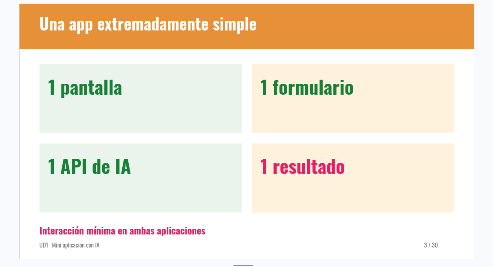

# ¿Qué habría pasado si...?

Aplicación web para plantear preguntas hipotéticas y explorar cómo podrían cambiar la historia, la sociedad o la vida cotidiana en universos alternativos. (Pregunta cualquier cosa jejejej)

Por ejemplo: «¿Qué habría pasado si Internet se hubiese inventado en el 1AC?». Tendrás varios campos distintos de formulario para hacer una historia o una pregunta a tu gusto.

Esta aplicación se ha desarrollado en clase por Mario Hernández y Alejandro Suarez.

## Estado del proyecto

La aplicación se encuentra en una fase inicial centrada en la interfaz. Actualmente permite escribir una pregunta de hasta 280 caracteres, seleccionar una de las preguntas sugeridas y enviarla desde el formulario. La zona de resultado y el composable `useScenario` están preparados como base para la siguiente fase.

La generación de escenarios aún no está conectada: enviar una pregunta no produce todavía una respuesta. Tampoco hay integración con una API de IA ni configuración de credenciales.

De hecho, actualmente no está implementado todos los formularios ni nada del estilo, que irá planificando Alex para dividir el trabajo en front y back entre ambos.


## Requisitos


## Tecnologías

- [Nuxt 3](https://nuxt.com/) y [Vue 3](https://vuejs.org/)
- TypeScript
- [Tailwind CSS](https://tailwindcss.com/) mediante `@nuxtjs/tailwindcss`
- npm

## Requisitos

- Node.js y npm

## Puesta en marcha

Instala las dependencias:

```bash
npm install
```

Inicia el servidor de desarrollo:

```bash
npm run dev
```

Abre [http://localhost:3000](http://localhost:3000) en el navegador.

## Comandos disponibles

| Comando | Descripción |
| --- | --- |
| `npm run dev` | Inicia Nuxt en modo desarrollo. |
| `npm run build` | Genera el build de producción. |
| `npm run generate` | Genera el sitio estático. |
| `npm run preview` | Sirve localmente el build de producción. |

## Cómo está organizado

```text
pages/
  index.vue                 Página principal y coordinación de la pregunta

components/
  HypothesisForm.vue        Entrada de texto, contador y envío de la pregunta
  ExampleQuestions.vue      Preguntas sugeridas que rellenan el formulario
  ScenarioResult.vue        Presentación del resultado o estado vacío

composables/
  useScenario.ts            Estado y operaciones previstos para un escenario

types/
  scenario.ts               Tipos de consulta, resultado y estado

assets/
  css/
    main.css                Directivas de Tailwind CSS
```

La configuración general de Nuxt está en `nuxt.config.ts`. El título y la descripción de la página también se definen allí.

## Próximos pasos

- Conectar `useScenario` con un servicio de generación de escenarios.
- Implementar y mostrar los estados de carga, éxito y error.
- Renderizar en `ScenarioResult` la narración y las consecuencias devueltas por el servicio.
- Definir la configuración segura de la API necesaria para el entorno de desarrollo y producción.
