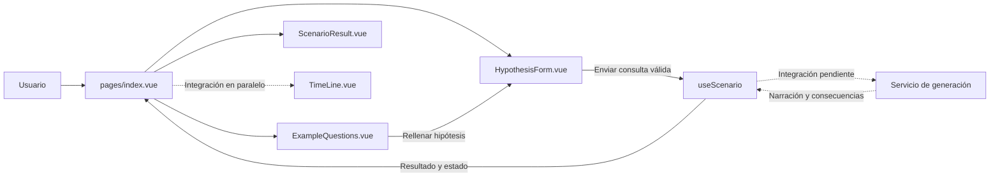
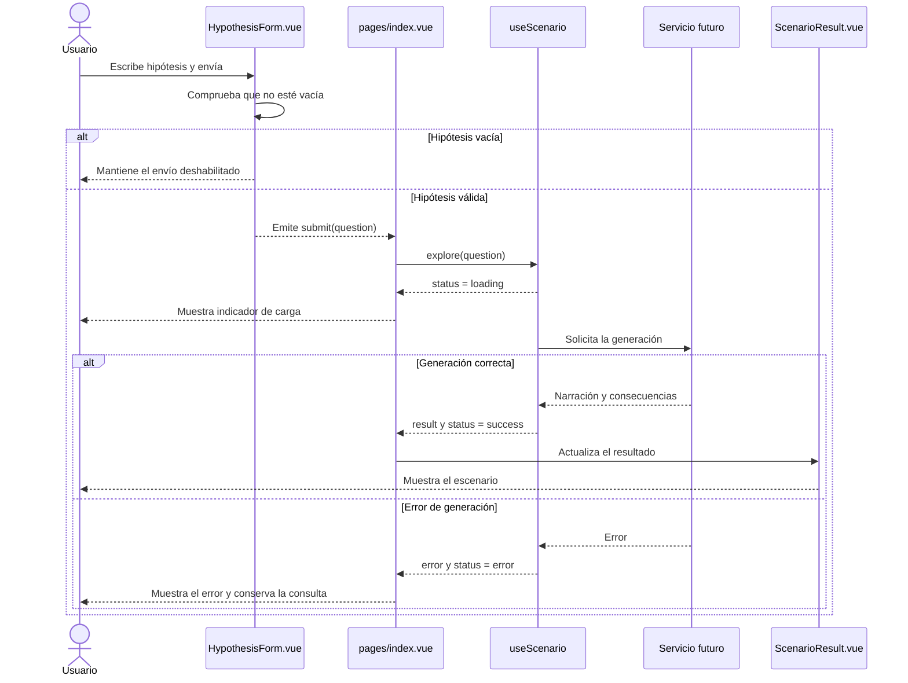
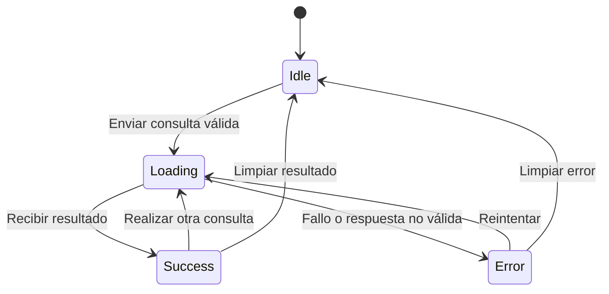
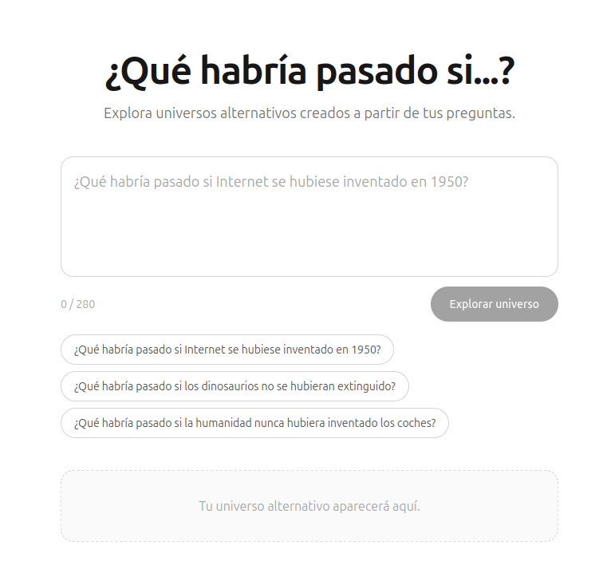

# ¿Qué habría pasado si...?

Aplicación web para plantear preguntas hipotéticas y explorar cómo podrían cambiar la historia, la sociedad o la vida cotidiana en universos alternativos. (Pregunta cualquier cosa jejejej)

Por ejemplo: «¿Qué habría pasado si Internet se hubiese inventado en el 1AC?». Tendrás varios campos distintos de formulario para hacer una historia o una pregunta a tu gusto.

Esta aplicación se ha desarrollado en clase por Mario Hernández y Alejandro Suarez.

## Estado del proyecto

La aplicación se encuentra en una fase inicial centrada en la interfaz. Actualmente permite escribir una pregunta de hasta 280 caracteres, seleccionar una de las preguntas sugeridas y enviarla desde el formulario. La zona de resultado y el composable `useScenario` están preparados como base para la siguiente fase.

La generación de escenarios aún no está conectada: enviar una pregunta no produce todavía una respuesta. Tampoco hay integración con una API de IA ni configuración de credenciales.

De hecho, actualmente no está implementado todos los formularios ni nada del estilo, que irá planificando Alex para dividir el trabajo en front y back entre ambos.

## Diseño de la aplicación

La experiencia se plantea como una página principal sencilla: la persona define un punto de divergencia, añade el contexto que considere útil y consulta una explicación de cómo podría desarrollarse ese universo alternativo.

### Diseño de la pantalla

1. **Cabecera:** título y una frase breve que invite a plantear una hipótesis.
2. **Formulario:** campo obligatorio para la pregunta o punto de divergencia. Como ampliación, se proponen campos opcionales para el contexto temporal o geográfico, los ámbitos que se quieren explorar (por ejemplo, ciencia, sociedad o economía) y el enfoque narrativo.
3. **Preguntas de ejemplo:** accesos rápidos que rellenan el campo principal y permiten editarlo antes de enviarlo.
4. **Resultado:** espacio para la narración y una lista de consecuencias. Se contempla una visualización cronológica con `TimeLine.vue`, que se está desarrollando en paralelo; su integración y contrato se acordarán con su responsable.
5. **Estados:** el área de resultado debe distinguir entre estado vacío, generación en curso, respuesta disponible y error recuperable.

El formulario actual ya permite escribir una pregunta de hasta 280 caracteres, elegir ejemplos y bloquear el envío de una pregunta vacía. Los campos adicionales, la generación y los estados de resultado descritos a continuación son objetivos de diseño, no funcionalidades terminadas.

### Requisitos funcionales

| ID | Requisito | Estado |
| --- | --- | --- |
| RF-01 | Permitir escribir una hipótesis de hasta 280 caracteres y no aceptar una entrada vacía. | Implementado |
| RF-02 | Permitir seleccionar una pregunta de ejemplo y cargarla en el campo de hipótesis. | Implementado |
| RF-03 | Permitir añadir contexto temporal o geográfico y, opcionalmente, elegir ámbitos y enfoque narrativo. | Propuesto |
| RF-04 | Enviar la consulta válida al servicio de generación sin bloquear la interfaz. | Pendiente |
| RF-05 | Mostrar la narración y sus consecuencias en el área de resultado. | Pendiente |
| RF-06 | Mostrar estados de carga y error, permitir reintentar y conservar la consulta ante un fallo. | Pendiente |
| RF-07 | Presentar los hitos del escenario en una cronología cuando se acuerde la integración de `TimeLine.vue`. | Pendiente de coordinación |

### Requisitos no funcionales

| ID | Requisito |
| --- | --- |
| RNF-01 | La interfaz debe adaptarse a móvil y escritorio sin perder acceso al formulario ni al resultado. |
| RNF-02 | Los controles deben poder utilizarse con teclado, tener etiquetas comprensibles y mostrar claramente el foco y los errores. |
| RNF-03 | La aplicación debe mantener la clave de cualquier proveedor de IA en el servidor; nunca debe exponerse en el cliente. |
| RNF-04 | La validación debe realizarse también en el servidor y los errores del servicio no deben borrar la hipótesis escrita. |
| RNF-05 | La interfaz debe comunicar la espera de forma inmediata y recuperarse de errores de red o respuestas no válidas. |
| RNF-06 | Los componentes, el estado del escenario y sus tipos deben mantenerse separados para facilitar el trabajo en paralelo. |
| RNF-07 | Solo deben enviarse al servicio los datos necesarios para generar el escenario, informando a la persona si se incorporan servicios externos. |

### Diagrama de componentes

El diagrama muestra la arquitectura prevista. La conexión con el servicio y la incorporación de `TimeLine.vue` están pendientes; las flechas discontinuas indican esa planificación.



### Diagrama de secuencia

Este es el flujo objetivo para cuando se conecte el servicio de generación. La llamada a la API y la presentación de sus estados todavía no están implementadas.



### Ciclo de estados

Los estados corresponden a `ScenarioStatus`. El recorrido completo describe el comportamiento previsto cuando se implemente la generación.






## Requisitos


## Tecnologías

- [Nuxt 3](https://nuxt.com/) y [Vue 3](https://vuejs.org/)
- TypeScript
- [Tailwind CSS](https://tailwindcss.com/) mediante `@nuxtjs/tailwindcss`
- npm

## Requisitos

- Node.js y npm

## Puesta en marcha

Instala las dependencias:

```bash
npm install
```

Inicia el servidor de desarrollo:

```bash
npm run dev
```

Abre [http://localhost:3000](http://localhost:3000) en el navegador.

## Comandos disponibles

| Comando | Descripción |
| --- | --- |
| `npm run dev` | Inicia Nuxt en modo desarrollo. |
| `npm run build` | Genera el build de producción. |
| `npm run generate` | Genera el sitio estático. |
| `npm run preview` | Sirve localmente el build de producción. |

## Cómo está organizado

```text
pages/
  index.vue                 Página principal y coordinación de la pregunta

components/
  HypothesisForm.vue        Entrada de texto, contador y envío de la pregunta
  ExampleQuestions.vue      Preguntas sugeridas que rellenan el formulario
  ScenarioResult.vue        Presentación del resultado o estado vacío

composables/
  useScenario.ts            Estado y operaciones previstos para un escenario

types/
  scenario.ts               Tipos de consulta, resultado y estado

assets/
  css/
    main.css                Directivas de Tailwind CSS
```

La configuración general de Nuxt está en `nuxt.config.ts`. El título y la descripción de la página también se definen allí.

## Próximos pasos

- Conectar `useScenario` con un servicio de generación de escenarios.
- Implementar y mostrar los estados de carga, éxito y error.
- Renderizar en `ScenarioResult` la narración y las consecuencias devueltas por el servicio.
- Definir la configuración segura de la API necesaria para el entorno de desarrollo y producción.
